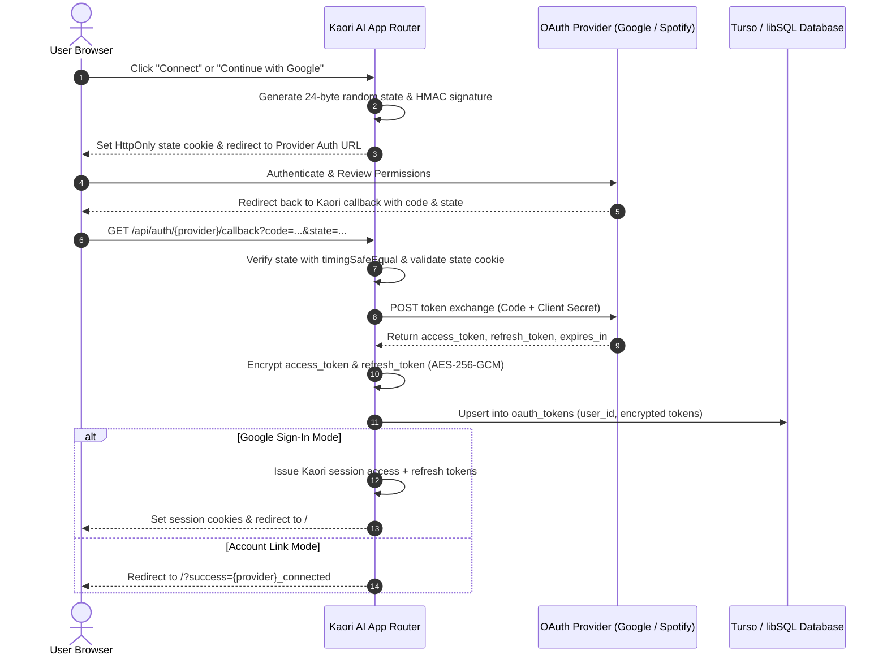

# OAuth in Kaori AI 🔐

A comprehensive guide to understanding, configuring, and securing OAuth 2.0 integrations in **Kaori AI**.

Kaori AI supports **Google OAuth 2.0** for Single Sign-On (SSO) and account linking, as well as **Spotify OAuth 2.0** for voice and chat-directed music playback control.

---

## Table of Contents

1. [What is OAuth & Why Do We Need It?](#what-is-oauth--why-do-we-need-it)
2. [Developer Keys vs. User Tokens](#developer-keys-vs-user-tokens)
3. [Supported Integrations & Scopes](#supported-integrations--scopes)
4. [Step-by-Step Developer Setup Guide](#step-by-step-developer-setup-guide)
   - [Google Cloud Console Setup](#1-google-cloud-console-setup)
   - [Spotify Developer Dashboard Setup](#2-spotify-developer-dashboard-setup)
5. [Environment Configuration Reference](#environment-configuration-reference)
6. [Security & Cryptographic Architecture](#security--cryptographic-architecture)
   - [AES-256-GCM Token Encryption](#1-aes-256-gcm-token-encryption-at-rest)
   - [CSRF & State Signature Validation](#2-state-signature--csrf-protection)
   - [Timing Attack Mitigation](#3-timing-attack-mitigation)
   - [QuartzWall Capability Firewall](#4-quartzwall-capability-firewall-integration)
7. [End-to-End Authentication Flow](#end-to-end-authentication-flow)
8. [Database Schema (`oauth_tokens`)](#database-schema-oauth_tokens)
9. [Troubleshooting & Error Codes](#troubleshooting--error-codes)

---

## What is OAuth & Why Do We Need It?

**OAuth 2.0 (Open Authorization)** is an open industry-standard protocol that allows Kaori AI to access third-party services (such as Google or Spotify) on a user's behalf **without ever seeing, handling, or storing their passwords**.

When a user asks Kaori:
> *"Play the latest track by Yoasobi on Spotify"* or *"Sign in with my Google account"*

Kaori needs delegated authority to execute those actions. Instead of asking for a username and password (which is dangerous and violates provider security rules), OAuth uses **scoped access tokens**.

### Key Advantages

- **Zero Credential Exposure**: Users authenticate directly on Google's or Spotify's official login screens. Kaori never receives passwords.
- **Granular Scopes**: Kaori only requests the exact permissions required (e.g., playback control for Spotify, identity profile for Google).
- **Instant Revocation**: Users can revoke Kaori's permissions at any time directly through their [Google Account Permissions](https://myaccount.google.com/permissions) or [Spotify Apps Dashboard](https://www.spotify.com/account/apps/).
- **Short-Lived Delegation**: Tokens expire and must be refreshed using encrypted refresh tokens.

---

## Developer Keys vs. User Tokens

A common point of confusion when setting up OAuth is:

> *"If I (the developer) put Google or Spotify credentials into `.env.local`, how does Kaori connect to other users' accounts?"*

OAuth operates using **two separate tiers of credentials**:

```
+--------------------------------------------------------------------------------+
|                             TIER 1: DEVELOPER KEYS                             |
|                        (Stored in your .env.local file)                        |
|                                                                                |
|  * GOOGLE_CLIENT_ID & GOOGLE_CLIENT_SECRET                                     |
|  * SPOTIFY_CLIENT_ID & SPOTIFY_CLIENT_SECRET                                   |
|                                                                                |
|  Identifies the APP (Kaori AI) to Google/Spotify.                              |
|  Acts like Kaori's verified digital business license.                          |
|  Does NOT grant access to any user data by itself.                            |
+---------------------------------------+----------------------------------------+
                                        |
                 User clicks "Connect" or "Sign In"
                                        |
                                        v
+--------------------------------------------------------------------------------+
|                              TIER 2: USER TOKENS                               |
|                  (Encrypted in Turso database: oauth_tokens)                   |
|                                                                                |
|  * access_token_enc (AES-256-GCM encrypted)                                    |
|  * refresh_token_enc (AES-256-GCM encrypted)                                   |
|                                                                                |
|  Belongs to INDIVIDUAL USERS who authorized Kaori on Google or Spotify.        |
|  Scoped strictly to the user's personal account and requested permissions.     |
+--------------------------------------------------------------------------------+
```

Every user who interacts with Kaori authenticates independently. The keys in `.env.local` establish application identity; user tokens in the database authorize actions for that specific user.

---

## Supported Integrations & Scopes

Kaori AI strictly requests the minimal permissions necessary to operate:

| Provider | Purpose | Endpoints | Scopes Requested | Description |
| :--- | :--- | :--- | :--- | :--- |
| **Google** | Single Sign-On (SSO) & Account Linking | `/api/auth/google`<br>`/api/auth/google/callback` | `openid`<br>`email`<br>`profile` | Allows passwordless sign-in, automatic account creation, and profile verification. Avoids Google restricted scopes to eliminate mandatory external app verification. |
| **Spotify** | Music & Playlist Playback Control | `/api/auth/spotify`<br>`/api/auth/spotify/callback` | `user-read-playback-state`<br>`user-modify-playback-state`<br>`user-read-currently-playing`<br>`playlist-read-private` | Powers the `play_spotify` tool. Enables Kaori to inspect playback status, start tracks/playlists on active devices, and generate deep-links (`spotify://`) with web fallbacks. |

---

## Step-by-Step Developer Setup Guide

### 1. Google Cloud Console Setup

To enable Google Sign-In and account linking:

1. **Open the Google Cloud Console**:
   Navigate to [console.cloud.google.com](https://console.cloud.google.com/).
2. **Create or Select a Project**:
   Click the project dropdown in the top navigation bar and select **New Project** (e.g., `kaori-ai-local`).
3. **Configure the OAuth Consent Screen**:
   - Go to **APIs & Services** > **OAuth consent screen**.
   - Select **External** user type and click **Create**.
   - Fill in required app details:
     - **App name**: `Kaori AI`
     - **User support email**: Your email address
     - **Developer contact information**: Your email address
   - In the **Scopes** step, click **Add or Remove Scopes** and select:
     - `.../auth/userinfo.email`
     - `.../auth/userinfo.profile`
     - `openid`
   - In the **Test users** step (while in Testing status), add your Google account email address so you can test logging in.
4. **Create OAuth 2.0 Client Credentials**:
   - Navigate to **APIs & Services** > **Credentials**.
   - Click **+ CREATE CREDENTIALS** > **OAuth client ID**.
   - Set **Application type** to `Web application`.
   - Set **Name** to `Kaori AI Web Client`.
   - **Authorized JavaScript origins**:
     - `http://localhost:3000` (for local development)
     - `https://your-domain.com` (for production)
   - **Authorized redirect URIs**:
     - `http://localhost:3000/api/auth/google/callback` (for local development)
     - `https://your-domain.com/api/auth/google/callback` (for production)
   - Click **Create**.
5. **Copy Keys to `.env.local`**:
   Copy your **Client ID** and **Client Secret** into your `.env.local` file.

---

### 2. Spotify Developer Dashboard Setup

To enable Spotify music playback control:

1. **Open the Spotify Developer Dashboard**:
   Navigate to [developer.spotify.com/dashboard](https://developer.spotify.com/dashboard) and log in with your Spotify account.
2. **Create an App**:
   - Click **Create App** in the dashboard.
   - **App Name**: `Kaori AI`
   - **App Description**: `AI assistant with music playback integration`
   - **Redirect URIs**:
     - `http://localhost:3000/api/auth/spotify/callback` (for local development)
     - `https://your-domain.com/api/auth/spotify/callback` (for production)
   - Select **Web API** under APIs used, agree to the terms, and click **Save**.
3. **Retrieve Credentials**:
   - In your newly created app page, click **Settings**.
   - Copy the **Client ID**.
   - Click **View client secret** and copy the **Client Secret**.
4. **Add Test Users (Mandatory in Development Mode)**:
   - In Spotify's Dashboard, unapproved apps are locked to **Development Mode**.
   - Navigate to **Settings** > **User Management**.
   - Add the Spotify email addresses and names of any accounts you want to test with.
5. **Copy Keys to `.env.local`**:
   Paste the credentials into your `.env.local` file.

---

## Environment Configuration Reference

Add these variables to your `.env.local` file in the root directory:

```env
# ==============================================================================
# SECURITY & ENCRYPTION KEYS (Mandatory for Token Storage & State Signing)
# ==============================================================================
# Minimum 32-character high-entropy secret for AES-256-GCM token encryption
ENCRYPTION_KEY=replace-with-a-random-32-byte-hex-or-string-secret

# Refresh token & HMAC state signing secret (must be distinct from JWT_SECRET)
JWT_REFRESH_SECRET=replace-with-another-random-32-byte-secret

# Base application origin (without trailing slash)
NEXT_PUBLIC_BASE_URL=http://localhost:3000

# ==============================================================================
# GOOGLE OAUTH 2.0 (Single Sign-On & Account Sync)
# ==============================================================================
GOOGLE_CLIENT_ID=your-google-client-id.apps.googleusercontent.com
GOOGLE_CLIENT_SECRET=GOCSPX-your-google-client-secret
GOOGLE_REDIRECT_URI=http://localhost:3000/api/auth/google/callback

# ==============================================================================
# SPOTIFY OAUTH 2.0 (Playback Control & Playlists)
# ==============================================================================
SPOTIFY_CLIENT_ID=your-spotify-client-id
SPOTIFY_CLIENT_SECRET=your-spotify-client-secret
SPOTIFY_REDIRECT_URI=http://localhost:3000/api/auth/spotify/callback
```

> [!TIP]
> You can quickly generate secure 32-byte keys for `ENCRYPTION_KEY` and `JWT_REFRESH_SECRET` by running:
> ```bash
> node -e "console.log(require('crypto').randomBytes(32).toString('hex'))"
> ```

---

## Security & Cryptographic Architecture

Kaori AI enforces an enterprise-grade zero-trust model for external OAuth tokens:

```
+-------------------+      Plaintext Token       +-------------------------+
| Provider Callback | -------------------------> | AES-256-GCM Encryption |
+-------------------+                            +-------------------------+
                                                              |
                                                              v
                                              Ciphertext Format (Base64):
                                                 iv : authTag : ciphertext
                                                              |
                                                              v
                                                 +--------------------------+
                                                 | Stored in Turso (db.ts)  |
                                                 | Table: oauth_tokens      |
                                                 +--------------------------+
```

### 1. AES-256-GCM Token Encryption at Rest
- Tokens are encrypted immediately upon reception in the callback routes using `encrypt()` from [`src/app/api/lib/crypto.ts`](file:///c:/Users/HARI%20KARTHICK%20G/OneDrive/Desktop/Kaori%20AI/src/app/api/lib/crypto.ts).
- Uses authenticated **AES-256-GCM** with a distinct 12-byte initialization vector (IV) per token and a 16-byte authentication tag.
- Ciphertext is stored formatted as:
  ```
  [Base64 IV] : [Base64 AuthTag] : [Base64 Ciphertext]
  ```
- **Key Isolation**: The encryption key is derived via `crypto.createHash("sha256").update(ENCRYPTION_KEY).digest()`. It is never shared with `JWT_SECRET`. If session tokens are intercepted, stored OAuth tokens remain secure.

### 2. State Signature & CSRF Protection
To prevent Cross-Site Request Forgery (CSRF) and State Fixation attacks:
- When initiating an OAuth handshake, [`createOAuthState()`](file:///c:/Users/HARI%20KARTHICK%20G/OneDrive/Desktop/Kaori%20AI/src/app/api/lib/auth-utils.ts#L201-L207) creates a 24-byte cryptographically secure random token (`crypto.randomBytes(24).toString("base64url")`).
- An HMAC-SHA256 signature is calculated over `provider:userId:state` using `JWT_REFRESH_SECRET`.
- The cookie value `${userId}.${state}.${signature}` is set in an `HttpOnly`, `SameSite: Lax`, `Secure` (production) cookie named `kaori_oauth_state_<provider>` with a short 10-minute time-to-live (`maxAge: 600`).
- On callback, [`verifyOAuthState()`](file:///c:/Users/HARI%20KARTHICK%20G/OneDrive/Desktop/Kaori%20AI/src/app/api/lib/auth-utils.ts#L209-L231) confirms that the returned state matches the cookie state, validates the cryptographic signature, and ensures the requesting session matches the target user.

### 3. Timing Attack Mitigation
State signature comparisons use `crypto.timingSafeEqual()` to eliminate side-channel timing attack vectors:
```typescript
if (
  expectedBuffer.length !== signatureBuffer.length ||
  !crypto.timingSafeEqual(expectedBuffer, signatureBuffer)
) {
  return null;
}
```

### 4. QuartzWall Capability Firewall Integration
For actions that interface with external providers (such as playing music via Spotify):
- The AI does not blindly trigger playback. Every tool invocation passes through **QuartzWall** ([`src/app/api/lib/quartzwall/capability-firewall.ts`](file:///c:/Users/HARI%20KARTHICK%20G/OneDrive/Desktop/Kaori%20AI/src/app/api/lib/quartzwall/capability-firewall.ts)).
- Intent validation regexes ensure the user explicitly requested music playback before the tool can be dispatched.
- Outbound URI schemes (`spotify:`) and web fallbacks (`open.spotify.com`) are checked against strict allowlists to prevent prompt injection and unauthorized protocol execution.

---

## End-to-End Authentication Flow

The following sequence details how Kaori AI initiates the handshake, handles authorization codes, encrypts tokens, and connects external accounts:



---

## Database Schema (`oauth_tokens`)

OAuth tokens are stored in the `oauth_tokens` table defined in [`db/schema.sql`](file:///c:/Users/HARI%20KARTHICK%20G/OneDrive/Desktop/Kaori%20AI/db/schema.sql#L142-L152):

```sql
CREATE TABLE IF NOT EXISTS oauth_tokens (
  id TEXT PRIMARY KEY,
  user_id TEXT NOT NULL REFERENCES users(id) ON DELETE CASCADE,
  provider TEXT NOT NULL,
  access_token_enc TEXT NOT NULL,
  refresh_token_enc TEXT,
  expires_at INTEGER,
  scope TEXT,
  created_at INTEGER NOT NULL DEFAULT (unixepoch()),
  UNIQUE(user_id, provider)
);
```

| Field | Type | Description |
| :--- | :--- | :--- |
| `id` | `TEXT` | Unique UUID v4 for the token entry |
| `user_id` | `TEXT` | Foreign key referencing the authenticated user in `users(id)` |
| `provider` | `TEXT` | Provider identifier (`google` or `spotify`) |
| `access_token_enc` | `TEXT` | AES-256-GCM encrypted access token (`iv:authTag:ciphertext`) |
| `refresh_token_enc` | `TEXT` | AES-256-GCM encrypted refresh token (nullable) |
| `expires_at` | `INTEGER` | Unix epoch timestamp indicating token expiration time |
| `scope` | `TEXT` | Granted OAuth scopes returned by the provider |
| `created_at` | `INTEGER` | Unix epoch timestamp of initial account connection |

---

## Troubleshooting & Error Codes

When an OAuth redirect or authentication attempt encounters an issue, Kaori AI redirects with an error query parameter. Use the guide below to resolve common issues:

| Query Parameter Error | Cause | Resolution |
| :--- | :--- | :--- |
| `google_not_configured`<br>`spotify_not_configured` | The environment variables for the provider are missing or empty in `.env.local`. | Ensure `*_CLIENT_ID`, `*_CLIENT_SECRET`, and `*_REDIRECT_URI` are properly filled out in `.env.local` and restart your dev server. |
| `google_state_invalid`<br>`spotify_state_invalid` | State cookie expired (10 min TTL), cookie was cleared, or HMAC verification failed. | Ensure cookies are enabled in your browser, your system clock is accurate, and retry connecting directly from the UI. |
| `google_auth_failed`<br>`spotify_auth_failed` | User cancelled or denied the permission request on the provider's screen. | Re-initiate connection and click "Allow" / "Agree" on Google or Spotify's consent screen. |
| `google_missing_params`<br>`spotify_missing_params` | Provider callback URL was called without the required `code` or `state` query parameters. | Check that the callback URL in your provider dashboard matches your application route exactly. |
| `google_token_failed`<br>`spotify_token_failed` | Token exchange request to provider failed (invalid client secret or mismatched redirect URI). | Verify your `*_CLIENT_SECRET` and ensure the configured redirect URI matches the one registered in the provider console character-for-character. |
| `google_profile_failed`<br>`google_email_missing` | Could not fetch Google user profile or email was private/empty. | Ensure the `email` scope is included in your Google OAuth consent screen configuration. |
| `redirect_uri_mismatch` *(Provider Screen)* | The redirect URI in the request doesn't match the dashboard allowlist. | Add `http://localhost:3000/api/auth/google/callback` or `.../spotify/callback` to the provider dashboard's Authorized Redirect URIs list. |
| `User not registered` *(Spotify Screen)* | Spotify app is in **Development Mode** and current account is not allowlisted. | Go to Spotify Developer Dashboard > App > **User Management** and add your Spotify email address. |

---

## Summary Checklist for Getting Started

- [ ] Create Google OAuth credentials in Google Cloud Console with scopes `openid email profile`.
- [ ] Create Spotify App in Spotify Developer Dashboard and add redirect URI.
- [ ] Add your Spotify account email to Spotify User Management (while in dev mode).
- [ ] Generate 32-byte keys for `ENCRYPTION_KEY` and `JWT_REFRESH_SECRET`.
- [ ] Save all credentials in `.env.local`.
- [ ] Restart dev server (`npm run dev`) and test connecting from **Settings > Integrations** or the **Sign In** page.
